<div align="center">

<!-- VIP Animated Header Banner -->


<br/><br/>

<!-- Party Parrots Squad + Typing SVG -->
&nbsp;
&nbsp;
&nbsp;
&nbsp;
&nbsp;
&nbsp;


<br/>

<a href="https://git.io/typing-svg">
  
</a>

<br/><br/>

&nbsp;&nbsp;
&nbsp;&nbsp;


<br/><br/>


</div>

---

### 🎬 Góc Giải Trí VIP (Chống Trầm Cảm Khi Debug)

<div align="center">

<table width="100%">
  <tr>
    <td width="50%" align="center">
      
      <br/><br/>
      <b>⚡ Khi deadline còn đúng 5 phút</b>
    </td>
    <td width="50%" align="center">
      
      <br/><br/>
      <b>🪄 Khi code chạy mà không hiểu tại sao</b>
    </td>
  </tr>
  <tr>
    <td width="50%" align="center">
      
      <br/><br/>
      <b>🎭 Khi lỡ có bug ngay lúc đi demo</b>
    </td>
    <td width="50%" align="center">
      
      <br/><br/>
      <b>💥 Mỗi lần <code>git pull</code> và dính conflict</b>
    </td>
  </tr>
  <tr>
    <td width="50%" align="center">
      
      <br/><br/>
      <b>🕵️ Chiến dịch săn bug lúc 3 giờ sáng</b>
    </td>
    <td width="50%" align="center">
      
      <br/><br/>
      <b>🧠 Debug đẳng cấp vũ trụ</b>
    </td>
  </tr>
  <tr>
    <td width="50%" align="center">
      
      <br/><br/>
      <b>💀 Khi lỡ tay gõ <code>rm -rf /</code> nhầm chỗ</b>
    </td>
    <td width="50%" align="center">
      
      <br/><br/>
      <b>😩 Khi sáng thứ 2 lại ập tới</b>
    </td>
  </tr>
</table>

</div>

---

### 🎮 Kho Hoạt Ảnh & Phòng Arcade Ẩn

<details open>
<summary><b>🦖 Arcade Retro Zone (Khủng Long & Pacman)</b></summary>
<br/>
<div align="center">
<table width="100%">
  <tr>
    <td width="55%" align="center">
      
      <br/><i>Khi mất mạng nhưng tay vẫn phải bấm</i>
    </td>
    <td width="45%" align="center">
      
      <br/><i>Ăn hết bug trước khi bug ăn mình</i>
    </td>
  </tr>
</table>
</div>
</details>

<details>
<summary><b>☕ Góc Chill Đêm Khuya & Cà Phê</b></summary>
<br/>
<div align="center">
<table width="100%">
  <tr>
    <td width="34%" align="center">
      
      <br/><i>Code trong yên bình</i>
    </td>
    <td width="33%" align="center">
      
      <br/><i>Nhiên liệu duy trì sự sống</i>
    </td>
    <td width="33%" align="center">
      
      <br/><i>Vòng lặp vĩnh cửu</i>
    </td>
  </tr>
</table>
</div>
</details>

<details>
<summary><b>😵 Hội Chứng Lập Trình Viên (Cười Ra Nước Mắt)</b></summary>
<br/>
<div align="center">
<table width="100%">
  <tr>
    <td width="34%" align="center">
      
      <br/><i>Cả ngày không code được dòng nào</i>
    </td>
    <td width="33%" align="center">
      
      <br/><i>Áp lực ngang núi</i>
    </td>
    <td width="33%" align="center">
      
      <br/><i>Não bộ: Error 404</i>
    </td>
  </tr>
</table>
</div>
</details>

---

### 👾 Biệt Đội Pixel Cổ Vũ

<div align="center">
  &nbsp;&nbsp;
  &nbsp;&nbsp;
  &nbsp;&nbsp;
  &nbsp;&nbsp;
  
</div>

---

### 🧠 Nhật Ký Sinh Tồn Của Dân Code

```diff
+ Hôm nay: Code mượt bất thường -> đang nghi có gì đó sai sai
- Hôm qua: Xóa 1 dòng comment, nguyên hệ thống sập
! Quy tắc vàng: Đang chạy ổn thì CẤM ĐỤNG VÀO
# Tốc độ làm việc: Tỉ lệ thuận với độ gần của deadline
```

---

<div align="center">


<br/><br/>

<!-- VIP Animated Footer -->


<br/><br/>

<a href="https://github.com/dinhquan1005">
  
</a>

</div>
