<div align="center">

<!-- Animated Header Banner -->


<br/><br/>

<!-- Typing SVG -->
<a href="https://git.io/typing-svg">
  
</a>

<p align="center">
  
  
  
  
</p>

</div>

---

### ⚡ System Telemetry & Primitives

```diff
+ HOST: dinhquan1005
+ INSTRUCTION SET: x86_64 · AVX2 · SSE4.2
+ SUBSYSTEMS: Win32 Native NT API · Direct3D 11 · Linux POSIX
+ MEMORY MODEL: Zero-copy RPM / Trampoline Hook Engine
+ OBSERVABILITY: PEB Walk · DJB2 Export Resolver · Syscall Stubs
```

---

### 🛠️ Arsenal & Tech Stack

<div align="center">

<a href="https://skillicons.dev">
  
</a>

<br/><br/>

| Domain | Primitives & Technologies | Environment |
|:---|:---|:---|
| **Core Systems** | `C++20` `Rust` `x86_64 ASM` `C` | MSVC · Clang · Cargo · CMake |
| **Analysis & Hooks** | MinHook · VMT Hooking · AOB Scan · PEB Walk | IDA Pro · x64dbg · Ghidra · CE |
| **Graphics & I/O** | Direct3D 11 Overlay · SendInput · Event Polling | Visual Studio 2022 · NeoVim |

</div>

---

### 📊 Telemetry & Coding Velocity

<div align="center">

<table border="0">
  <tr>
    <td>
      
    </td>
    <td>
      
    </td>
  </tr>
  <tr>
    <td>
      
    </td>
    <td>
      
    </td>
  </tr>
</table>

</div>

---

### 💃 Vibe & Resonance

<div align="center">


</div>

---

### 📂 Architecture & Research Logs

<details>
<summary><b>🔍 Low-Level Instrumentation Primitives (Click to expand)</b></summary>
<br/>

```text
├── External Engine Derivation
│   ├── OpenProcess + ReadProcessMemory (zero-copy buffer pool)
│   ├── Signature Scanner: C++20 AVX2 SIMD mask compare
│   └── SendInput (MOUSEEVENTF_MOVE) coordinate mapping
│
└── Internal Hook Engine
    ├── VirtualProtect PAGE_EXECUTE_READWRITE byte-patch
    ├── Trampoline allocation within ±2GB range (Rel32 call/jmp)
    └── PEB walk + DJB2 export resolver for indirect syscalls
```

</details>

---

<div align="center">

`[c4]` · dinhquan1005 session bench

</div>
